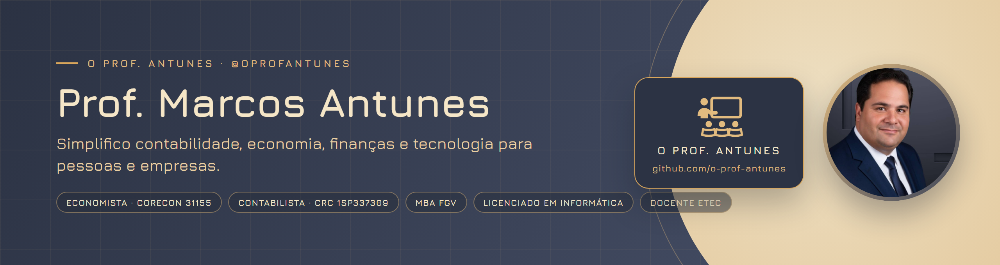
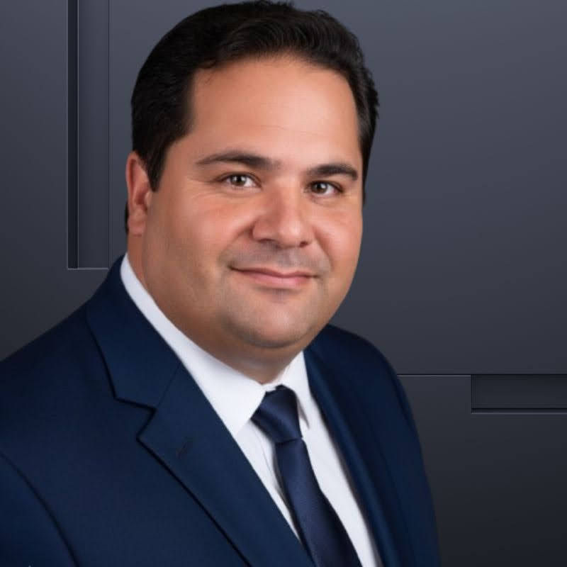

# Prof. Marcos Antunes (`@oprofantunes`)

> **“Simplifico contabilidade, economia, finanças e tecnologia para pessoas e empresas.”**

Sou **Marcos Antunes**, economista (**CORECON 31155**), contabilista (**CRC 1SP337309**), Licenciado em Informática e pós-graduado em Coordenação Pedagógica e em Gestão Estratégica em Vendas (MBA FGV), com base em **São Manuel (SP)**. Ao longo de mais de duas décadas entre a sala de aula, a gestão empresarial e projetos de tecnologia da informação, construí uma atuação prática voltada a traduzir números, normas fiscais e decisões estratégicas em ferramentas acessíveis para estudantes e empresas.

Atualmente atuo como **Professor do Ensino Médio e Técnico na ETEC (Centro Paula Souza)**, **Consultor de Inteligência Empresarial na Ne4x Consulting**, **Fundador e Diretor Executivo da Ne4x — Informática e Tecnologia** e **Contabilista Autônomo (CRC 1SP337309)**.

- **Currículo completo:** [Markdown](cv/curriculo-marcos-antunes.md) · [PDF Editorial](cv/curriculo-marcos-antunes.pdf) · [Arte Visual (PNG)](cv/curriculo-marcos-antunes-arte.png) · [Word DOC](cv/curriculo-marcos-antunes.doc) · [Word DOCX](cv/curriculo-marcos-antunes.docx)
- **Apresentação institucional:** [Apresentação Interativa (HTML)](cv/apresentacao-marcos-antunes.html) · [PDF (16:9)](cv/apresentacao-marcos-antunes.pdf) · [PowerPoint (PPTX)](cv/apresentacao-marcos-antunes.pptx)

 

---

## Onde Atuo Hoje

| Frente | Instituição / Empresa | Papel |
| :--- | :--- | :--- |
| **Docência Técnica** | ETEC — Escola Técnica Estadual de São Paulo (CPS) | Professor do Ensino Médio e Técnico *(out/2025 – atual; 2022–2024; Coordenação em Contabilidade em 2023)* |
| **Inteligência Empresarial** | Ne4x Consulting | Consultor de Inteligência Empresarial *(jun/2024 – atual)* |
| **Tecnologia da Informação** | Ne4x — Informática e Tecnologia | Fundador e Diretor Executivo *(jun/2017 – atual)* |
| **Contabilidade & Fiscal** | Escritório Próprio (Home Office · CRC 1SP337309) | Contabilista Autônomo *(ago/2017 – atual)* |

---

## Áreas de Especialidade

| Pilar | Foco Prático |
| :--- | :--- |
| **Docência & Materiais Didáticos** | Contabilidade, Economia e Mercado, Finanças, Administração, Logística, Recursos Humanos, Processamento de Dados e Informática — com produção autoral de capítulos em Markdown, apostilas em PDF, estudos de caso e listas de exercícios. |
| **Gestão Financeira & Controladoria** | Planos de negócios, análise de viabilidade econômica, orçamento anual e trienal, modelagem financeira, fluxo de caixa, BPO financeiro e estruturação de custos. |
| **Contábil & Fiscal** | Operação e consultoria em Simples Nacional, MEI, Lucro Presumido, IRPJ/CSLL, PIS/COFINS, ICMS, INSS, obrigações acessórias (SPED Fiscal, EFD, DCTF, PGDAS, GIA, SINTEGRA) e ECONET. |
| **Estratégia & Tecnologia** | Diagnóstico situacional, reestruturação, M&A, implantação de sistemas de gestão, automação, infraestrutura de TI e comércio eletrônico. |

---

## Trajetória Consolidada

- **Ensino e Coordenação:** Docência na **ETEC (Centro Paula Souza)** em São Manuel e coordenação do **Curso Técnico de Contabilidade** em Lençóis Paulista (2023). Anteriormente, atuei como Professor III de Economia e Mercado e Processamento de Dados na **ETM/ETC Prof. Carlos Bom** (2005 e 2007), Professor Eventual de Matemática na rede estadual e Instrutor de Informática na **Enter Informática** (1998–1999, mais de 100 alunos formados).
- **Controladoria e Varejo:** Técnico e Analista Contábil na **V.S. Assessoria Contábil** (2015–2017), operando integralmente as rotinas contábeis, fiscais e de departamento pessoal de carteira com 20 empresas de médio porte. Antes, liderei a gestão comercial, financeira e administrativa da **Calçados Antunes** (São Manuel e Botucatu), participando da expansão para 4 lojas e da conquista recorrente do prêmio de melhor loja de calçados pela Associação Comercial de São Manuel.
- **Empreendedorismo e Tecnologia:** Fundador da **Ne4x — Informática e Tecnologia** (2017–atual), sócio proprietário da **INFOTEM** (2006–2010), programador de e-commerce na **Soletrol / Hidraushop** (2006–2007) e atuação inicial em web design pela **Potencial Web Design** (1999–2003) e **DMZ Brasil** (2000–2002).

---

## Formação Acadêmica, Registros & Idiomas

- **Licenciatura em Informática** *(Formação Pedagógica)* — UNIASSELVI (concluído em jul/2024; colação de grau em out/2026)
- **Pós-Graduação Lato Sensu em Coordenação Pedagógica** *(480h)* — UNIASSELVI, 2024
- **MBA em Gestão Estratégica em Vendas** — Fundação Getulio Vargas (FGV), 2009
- **Bacharelado em Ciências Econômicas** — UNIFAC (Botucatu, SP), 2001 *(CORECON nº 31155)*
- **Técnico em Contabilidade** — ETM Prof. Carlos Bom (São Manuel, SP), 1996 *(CRC 1SP337309)*
- **Formação Complementar:** Tributação, Contabilidade e Reforma Trabalhista (*Nata Cursos*, 2016–2018; *Sage Brasil*, 2015), Gestão e Liderança (*Enterprise Plus*, *Sincovasa*, *Sebrae*, *Senac*, *ITE Bauru*, *UNESP*).
- **Idiomas:** Português (Nativo), Inglês (Profissional Completo) e Espanhol (Profissional Completo).

---

## Canais e Contato

- **GitHub:** [github.com/o-prof-antunes](https://github.com/o-prof-antunes)
- **LinkedIn:** [linkedin.com/in/antunesecn](https://www.linkedin.com/in/antunesecn)
- **Linktree:** [linktr.ee/antunesecn](https://linktr.ee/antunesecn)
- **E-mails:** [marcosantunesecnbr@gmail.com](mailto:marcosantunesecnbr@gmail.com) · [mantunescontabil@gmail.com](mailto:mantunescontabil@gmail.com)
- **Telefones / WhatsApp:** (14) 99115-0021 · (14) 99873-6034
