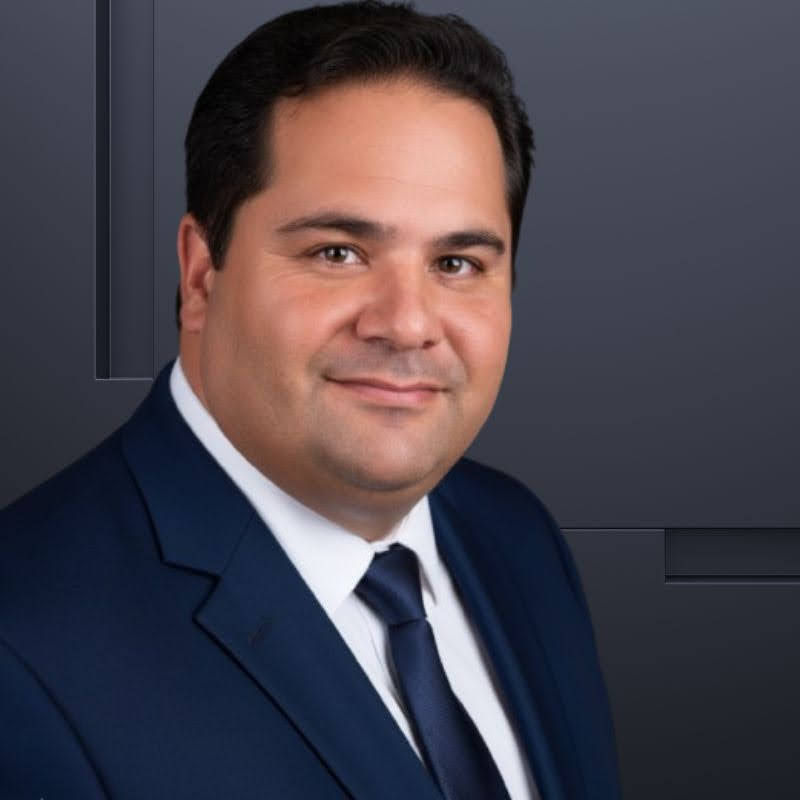

# Marcos Antunes

**CORECON 31155 · CRC 1SP337309 · Licenciado em Informática · Pós-Graduado em Coordenação Pedagógica · MBA FGV**  
*“Simplifico contabilidade, economia, finanças e tecnologia para pessoas e empresas.”*

**Base:** São Manuel, São Paulo — Brasil  
**Telefones / WhatsApp:** (14) 99115-0021 · (14) 99873-6034  
**E-mails:** [marcosantunesecnbr@gmail.com](mailto:marcosantunesecnbr@gmail.com) · [mantunescontabil@gmail.com](mailto:mantunescontabil@gmail.com)  
**GitHub:** [github.com/o-prof-antunes](https://github.com/o-prof-antunes)  
**LinkedIn:** [linkedin.com/in/antunesecn](https://www.linkedin.com/in/antunesecn)  
**Links:** [linktr.ee/antunesecn](https://linktr.ee/antunesecn)  
**Registros:** Economista (CORECON nº 31155) · Técnico em Contabilidade (CRC 1SP337309)

 

---

## Perfil Profissional

Economista (CORECON 31155), contabilista (CRC 1SP337309), Licenciado em Informática e pós-graduado em Coordenação Pedagógica (UNIASSELVI) e em Gestão Estratégica em Vendas (MBA FGV). Ao longo de mais de duas décadas de atuação, reuni a prática de sala de aula no ensino médio e técnico à gestão empresarial, à controladoria contábil-fiscal e à implantação de soluções em tecnologia da informação.

Minha atuação concentra-se em planejamento orçamentário, análise de viabilidade econômica, modelagem financeira, diagnóstico situacional e formação prática para o mercado de trabalho.

---

## Experiência na Docência e Coordenação

### Professor do Ensino Médio e Técnico
**ETEC — Escola Técnica Estadual de São Paulo (Centro Paula Souza)** · São Manuel, SP  
*Outubro de 2025 – Atual*

- Docência nos ensinos Técnico, Integrado, Médio e Especialização Técnica em Economia e Mercado, Administração Financeira e Orçamentária, Contabilidade, Logística e Recursos Humanos.
- Integração de fundamentos econômicos e contábeis a casos reais de gestão e tecnologia.

### Coordenador do Curso Técnico de Contabilidade
**ETEC — Escola Técnica Estadual de São Paulo (Centro Paula Souza)** · Lençóis Paulista, SP  
*Janeiro de 2023 – Dezembro de 2023*

- Elaboração do Projeto Político-Pedagógico (PPP) e do Plano Plurianual de Gestão (PPG).
- Coordenação do corpo docente e alinhamento das disciplinas ao Plano de Curso.
- Supervisão de estágio supervisionado e atividades práticas, avaliação de desempenho docente e condução de reuniões de curso.
- Análise de tendências do mercado de trabalho contábil e assessoria direta à Direção em demandas estratégicas.

### Professor do Ensino Médio e Técnico
**ETEC — Escola Técnica Estadual de São Paulo (Centro Paula Souza)** · São Manuel, SP  
*Maio de 2022 – Maio de 2024*

- Ministração de componentes curriculares de Economia e Mercado, Administração Financeira e Orçamentária e Contabilidade, com elaboração de apostilas, capítulos didáticos, estudos de caso e listas de exercícios.

### Professor III — Economia e Mercado e Processamento de Dados
**Escola Técnica Municipal (ETM/ETC) Prof. Carlos Bom** · São Manuel, SP  
*Fevereiro a dezembro de 2005 · Fevereiro a dezembro de 2007*

- Preparação e ministração de aulas para os cursos técnicos de Administração e Contabilidade.

### Professor Eventual de Matemática
**Escolas Estaduais de São Manuel e Pratânia** · São Paulo  

- Experiência em aulas de Matemática na rede pública estadual.

### Instrutor de Informática
**Enter Informática** · São Manuel, SP  
*Outubro de 1998 – Maio de 1999*

- Formação profissionalizante de mais de 100 alunos em DOS, Windows, Word, Excel, PowerPoint, Access e Internet.

---

## Experiência Executiva, Consultoria e Tecnologia

### Consultor de Inteligência Empresarial
**Ne4x Consulting** · Brasil  
*Junho de 2024 – Atual*

- Consultoria estratégica e econômico-financeira, diagnóstico situacional, modelagem financeira, M&A e reestruturação de empresas.
- Planejamento orçamentário anual e trienal, análise de viabilidade de investimentos e implantação de rotinas de controladoria.

### Fundador e Diretor Executivo
**Ne4x — Informática e Tecnologia** · São Manuel, SP  
*Junho de 2017 – Atual*

- Direção executiva e liderança de projetos em tecnologia da informação, infraestrutura, automação de processos e soluções digitais para empresas.

### Contabilista Autônomo (CRC 1SP337309)
**Escritório Próprio (Home Office)** · São Manuel, SP  
*Agosto de 2017 – Atual*

- Contabilidade geral, de custos e gerencial, departamento pessoal e controle patrimonial.
- Regularização de empresas, consultoria empresarial e atendimento à fiscalização.

### Técnico e Analista Contábil
**V.S. Assessoria Contábil** · São Manuel, SP  
*Novembro de 2015 – Agosto de 2017*

- Operação integral dos subsistemas contábil, fiscal e de departamento pessoal de carteira com 20 empresas de médio porte.
- Apuração de tributos (DAS MEI, DAS Simples Nacional, Lucro Presumido, INSS, PIS, COFINS, IRPJ, CSLL e ICMS) e entrega de obrigações acessórias (SPED Fiscal, EFD, DCTF, PGDAS, GIA, DeSTDA e SINTEGRA).
- Abertura, alteração e encerramento de empresas (incluindo MEI), certidões negativas de débito, encerramento de CEI/DISO e domínio da plataforma ECONET.

### Gerente Comercial e de Varejo
**Calçados Antunes** · São Manuel e Botucatu, SP  
*Maio de 2010 – Outubro de 2015 (atuação prévia em estoque, vendas e gerência entre 1995 e 2006)*

- Gestão comercial, financeira e administrativa da rede varejista familiar.
- Participação na expansão para 4 lojas, planejamento de compras, marketing, gestão de pessoas e conquista recorrente do prêmio de melhor loja de calçados pela Associação Comercial de São Manuel.

### Sócio Proprietário
**INFOTEM — Soluções em Informática** · São Manuel, SP  
*Setembro de 2006 – Junho de 2010*

- Gestão técnica e comercial na venda de equipamentos e suprimentos de informática, negociação com fornecedores e projetos sob medida para clientes corporativos.

### Programador de Internet | E-commerce
**Soletrol — Unidade Hidraushop Materiais Hidráulicos e Aquecimento Ltda.** · São Manuel, SP  
*Fevereiro de 2006 – Março de 2007*

- Desenvolvimento, implantação e administração da loja virtual da marca e operação das vendas on-line.

### Fundador & Web Master / Web Designer
**Potencial Web Design** *(1999 – 2003, São Manuel, SP)* · **DMZ Brasil — Agência de Internet** *(2000 – 2002, Fortaleza, CE)*

- Arquitetura, design e programação de websites e soluções digitais.

---

## Formação Acadêmica

| Formação | Instituição | Conclusão |
| :--- | :--- | :---: |
| **Licenciatura em Informática** *(Curso Superior de Formação Pedagógica em Informática)* | UNIASSELVI — Centro Universitário Leonardo da Vinci | Concl. jul/2024 · Colação out/2026 |
| **Pós-Graduação Lato Sensu em Coordenação Pedagógica** *(480 horas)* | UNIASSELVI — Centro Universitário Leonardo da Vinci | 2024 |
| **MBA em Gestão Estratégica em Vendas** *(Administração, Negócios, Marketing e Vendas)* | FGV — Fundação Getulio Vargas | 2009 |
| **Bacharelado em Ciências Econômicas** | UNIFAC — Botucatu, SP | 2001 |
| **Técnico em Contabilidade** | ETM Prof. Carlos Bom — São Manuel, SP | 1996 |

---

## Formação Complementar

| Curso / Aperfeiçoamento | Instituição | Ano |
| :--- | :--- | :---: |
| Reforma Trabalhista — Lei nº 13.467/2017 | Nata Cursos | 2018 |
| Lucro Presumido (IRPJ, CSLL, PIS e COFINS cumulativos) | Nata Cursos | 2017 |
| Simples Nacional e MEI | Nata Cursos | 2017 |
| ICMS Interestadual | Nata Cursos | 2017 |
| INSS sobre a Folha e sobre a Receita | Nata Cursos | 2017 |
| Imposto de Renda da Pessoa Física (IRPF) | Nata Cursos | 2017 |
| Contabilidade Geral Básica | Nata Cursos | 2016 |
| Folha de Pagamento | Sage Brasil | 2015 |
| Enterprise Plus — The Business Game | — | 2009 |
| Inteligência Emocional | Sincovasa | 2006 |
| Cadastro, Crédito e Cobrança | Alavanca | 2004 |

Cursos adicionais em empreendedorismo (*Sebrae* — Brasil Empreendedor; Iniciando um Pequeno Grande Negócio), gestão de loja e técnicas avançadas de vendas (*Associação Comercial de São Manuel*), vitrinismo (*Senac*), treinamento de vendas (*Reebok*), oratória forense (*ITE Bauru*) e filosofia (*UNESP Botucatu*).

---

## Especialidades, Serviços e Idiomas

- **Consultoria em Gestão Financeira:** Planos de negócios, análise de viabilidade econômica, orçamento anual e trienal e estruturação de custos.
- **Controladoria e BPO Financeiro:** Fluxo de caixa, modelagem financeira, contas a pagar/receber e relatórios de desempenho.
- **Inteligência Empresarial e Reestruturação:** Diagnóstico situacional, planejamento estratégico, M&A e implantação de sistemas de gestão.
- **Docência e Treinamentos Corporativos:** Workshops e cursos em economia aplicada, planejamento financeiro, contabilidade e empreendedorismo.
- **Idiomas:** Português (Nativo), Inglês (Profissional Completo) e Espanhol (Profissional Completo).

---

## Versões e Apresentação

[Versão Editorial em PDF](curriculo-marcos-antunes.pdf) · [Arte Visual (PNG)](curriculo-marcos-antunes-arte.png) · [Word DOC](curriculo-marcos-antunes.doc) · [Word DOCX](curriculo-marcos-antunes.docx) · [Apresentação Interativa (HTML)](apresentacao-marcos-antunes.html) · [Apresentação (PDF)](apresentacao-marcos-antunes.pdf) · [PowerPoint (PPTX)](apresentacao-marcos-antunes.pptx)
